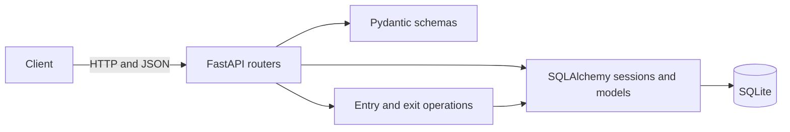

# Condominium Visitor Control API

A REST API for recording visitor arrivals and departures in residential condominiums. Building staff need to know whether a visit is active and be able to review the history for a unit. The API links each movement to a registered visitor and unit and enforces a single active visit per visitor and unit, including when requests arrive concurrently.

Use fictional data in this demonstration. Anyone who can reach the API can read and change its data.

## Features

- Register, list, update, and delete visitors.
- Register and list condominiums and their units.
- Record arrivals, close active visits, and list movements by unit.
- Explore the contract through Swagger UI at `/docs` and the OpenAPI schema at `/openapi.json`.
- Check API and database readiness at `/health`.

## Stack and architecture

Python 3.12, FastAPI, Pydantic 2, SQLAlchemy 2, and SQLite. uv installs from a lockfile, Ruff checks style and formatting, and pytest exercises the API against isolated SQLite files. Docker packages the service and GitHub Actions runs the checks on pull requests and pushes to `main`.



| Path | Responsibility |
| --- | --- |
| `app/main.py` | Application factory, lifespan, router registration, validation errors, and health endpoint |
| `app/database.py` | SQLite engine, foreign key enforcement, and request sessions |
| `app/models.py` | Tables, relationships, and database constraints |
| `app/schemas.py` | Request validation and response serialization |
| `app/routers/` | HTTP endpoints and resource checks |
| `app/crud.py` | Atomic access operations and optional demo seed |
| `tests/` | API and legacy database regression tests |
| `.github/workflows/ci.yml` | Lint, tests, and image build |

## Run locally

Install Python 3.12 and [uv](https://docs.astral.sh/uv/getting-started/installation/). From the repository root, run the following commands.

```bash
uv sync --locked
SEED_DEMO_DATA=1 uv run --locked uvicorn app.main:app --reload
```

Open `http://127.0.0.1:8000/docs`. Omit the seed variable to start with an empty database on the first run.

## Run with Docker

```bash
SEED_DEMO_DATA=1 docker compose up --build -d
docker compose ps
docker compose logs api
docker compose down
```

Compose binds port 8000 to loopback. The named volume preserves the database across container replacements and ordinary `docker compose down`. The image runs as UID and GID 10001. If you bind mount a host directory instead of the named volume, grant that UID write access to the directory.

If your build network uses a private CA, supply its trusted PEM bundle to BuildKit.

```bash
docker build --secret id=build_ca,src=/path/to/trusted-ca-bundle.pem -t visitor-control:local .
```

## Configuration and database

| Environment variable | Default | Purpose |
| --- | --- | --- |
| `DATABASE_PATH` | `test.db` locally, `/data/visitors.db` in Docker | Path to a SQLite file. Its parent directory must exist and allow writes. |
| `SEED_DEMO_DATA` | `0` | Set to `1` to insert fictional examples on startup when no condominiums exist. |

SQLite fits a single-service demonstration with modest write traffic and keeps setup self-contained. Startup creates missing tables, checks for broken foreign keys and inconsistent movement states, and adds the active-entry index to compatible existing databases. Existing tables and records are preserved. Back up legacy databases before upgrading. If the checks fail or duplicate active rows prevent index creation, review and reconcile the records before restarting. New tables enforce required fields and valid movement states. Existing tables retain their original definitions, so they do not gain every new table-level constraint. Introduce managed migrations when schema changes require a data transformation or coordinated rollout.

## API endpoints

Existing Portuguese paths and domain field names are retained. Paginated lists accept `skip` (at least 0) and `limit` (1 to 100). The default limit is 100.

| Method | Path | Success |
| --- | --- | --- |
| GET | `/` | 200, welcome message |
| GET | `/health` | 200, database reachable with the movement table present |
| GET, POST | `/visitantes/` | 200 list, 201 create |
| GET, PUT, DELETE | `/visitantes/{visitante_id}` | 200 read or replace, 204 delete |
| GET, POST | `/condominios/` | 200 list, 201 create |
| GET | `/condominios/{condominio_id}` | 200, condominium |
| GET | `/condominios/relacao/unidades` | 200, all condominiums with their units |
| GET | `/condominios/{condominio_id}/unidades` | 200, units, including an empty list for an existing condominium with no matching results |
| POST | `/condominios/{condominio_id}/unidades/` | 201, new unit |
| POST | `/controle-acesso/entrada` | 201, active movement |
| PUT | `/controle-acesso/saida/{movimentacao_id}` | 200, closed movement |
| GET | `/controle-acesso/unidades/{unidade_id}/movimentacoes` | 200, unit history |

### Example visit

With a freshly seeded database, unit 1 exists. Register a fictional visitor.

```bash
curl -sS http://127.0.0.1:8000/visitantes/ \
  -H 'Content-Type: application/json' \
  -d '{"nome":"Example Visitor","documento":"DEMO-002"}'
```

```json
{"id":2,"nome":"Example Visitor","documento":"DEMO-002","telefone":null}
```

Record an arrival and use the resulting movement ID to record departure. The example assumes the first movement has ID 1.

```bash
curl -sS http://127.0.0.1:8000/controle-acesso/entrada \
  -H 'Content-Type: application/json' \
  -d '{"visitante_id":2,"unidade_id":1,"observacoes":"Example delivery"}'
curl -sS -X PUT http://127.0.0.1:8000/controle-acesso/saida/1
curl -sS http://127.0.0.1:8000/controle-acesso/unidades/1/movimentacoes
```

Example history after departure.

```json
[
  {
    "id": 1,
    "visitante_id": 2,
    "unidade_id": 1,
    "observacoes": "Example delivery",
    "data_hora_entrada": "2026-01-10T14:00:00",
    "data_hora_saida": "2026-01-10T14:20:00",
    "ativa": false,
    "visitante": {"id": 2, "nome": "Example Visitor"},
    "unidade": {"id": 1, "numero": "101", "bloco": "A", "condominio_id": 1}
  }
]
```

### Business rules and errors

- A visitor and unit must exist before an arrival. Missing resources return 404.
- The database enforces one active entry per visitor and unit with a partial unique index. Simultaneous or repeated active entries return 409. A new arrival is allowed after departure.
- A departure atomically closes an active movement. An unknown movement returns 404 and an already closed movement returns 409.
- Foreign keys prevent deletion of visitors with active or closed movements. A deletion that would break history returns 409.
- Visitor documents and condominium names must be unique. Conflicts return 409. Replacing a visitor with a null or omitted phone clears it.
- Unit creation requires matching condominium IDs in the URL and body. A mismatch returns 400.
- Invalid fields return 422 without echoing the submitted field values. Visitor documents and phones appear in visitor management responses. Movement responses include only the visitor ID and name.
- New timestamps are recorded in UTC and serialized without offsets for compatibility. Legacy timestamps retain their original values.

## Automated checks

```bash
uv run --locked ruff check .
uv run --locked ruff format --check .
uv run --locked pytest
docker build -t visitor-control:local .
```

The tests isolate each database and include simultaneous requests, rejected deletions, invalid input, legacy movement preservation, and read-back of closed visits.

## Engineering decisions and limitations

The routers handle HTTP and resource lookups. Entry and exit writes use SQLite's atomic conflict handling and conditional updates, with database constraints as the final authority. The application uses one database session per request and initializes the database through the FastAPI lifespan.

Authentication and authorization are required before any deployment with real data. Establish roles and restrict access to personal fields, configure TLS, define retention and auditing policies, and review what operators record in free-text notes. This demo has no audit trail for visitor profile edits. SQLite serializes writers, so sustained concurrent writes or multiple deployments would warrant reassessing the storage architecture.
